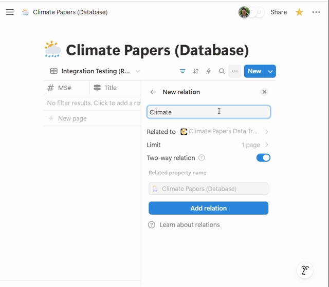
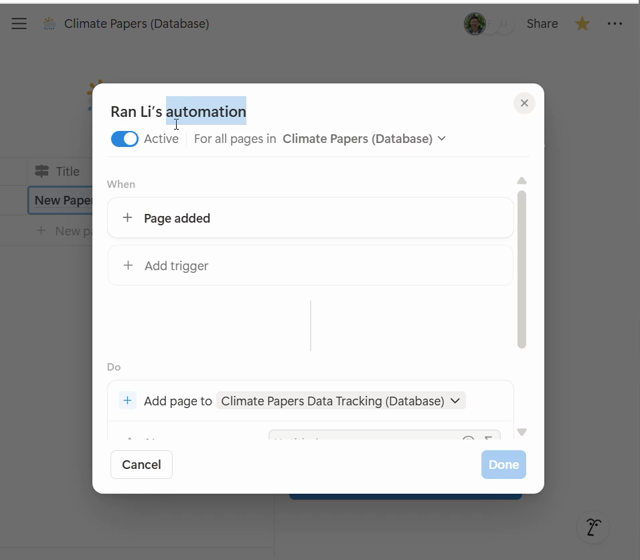
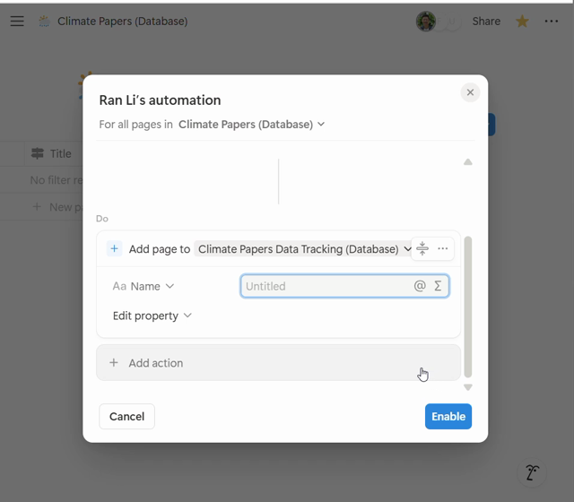
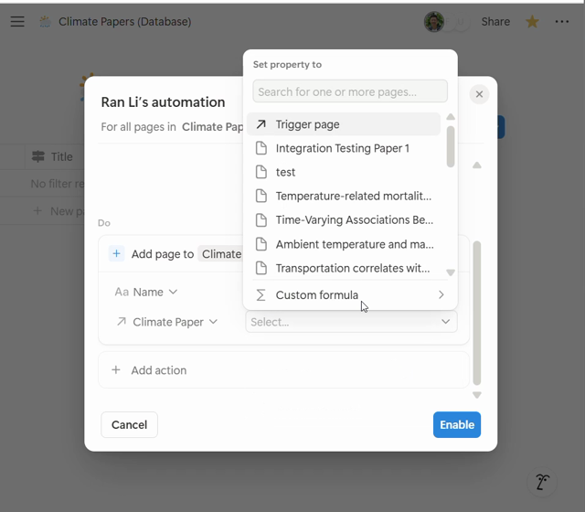
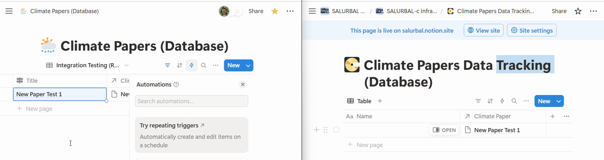

# Rambling

- so we setup a synced origni-copy database seutp in notino once. in  [salurbal-etl#285](https://github.com/SALURBAL-Climate/salurbal-etl/issues/285)) it was Fer's P&P databse and we wante  synce contrablabl verison for DMC to track data bundle Status
- Here we are just genrailzie adn dadopting it to aprotocl whichc anc be used by others foremxpale for caro and maanuscrpt database.
- below is the distilled protocl fomr the roignal PR

# Protocol

Checklist to reproduce the sync from scratch. Assumes the Claude Notion connector is set up, so Claude does the schema and row work and only automations need the Notion UI.

- 🤖 Claude does it through the connector.
- 🧑 You do it in the Notion UI.
- ⚠️ Unverified or unclear; iterate here.

Live test instance (2026-11-10): [Origin Database](https://app.notion.com/p/4b0d76038bcf4efc8f316279abeb05f8) → [Copy Database](https://app.notion.com/p/c336cd293d3d4ae49b09681f39233546), under [Notion Synced Databases Protocol Test](https://app.notion.com/p/41457008e88580cbb442d6f6fd6fb706). Checked boxes reflect that instance.

## Permissions config

Set in each database's **Share** panel. View on Origin is enough for the rollups to resolve; the Copy team only needs edit where its own `new_` columns live.

| Database | Owners | Copy team |
|---|---|---|
| Origin | Full | View |
| Copy | Full | Edit |

DMC reference (2026-11-10): Origin matches the table; Copy has the team at *Comment*, which blocks filling `new_` columns, so it should move to *Edit*. <a href="12-share-origin.png" class="lightbox" data-gallery="permissions" title="Origin: owners full, guests view, link view">(Snip: Origin)</a> <a href="13-share-copy.png" class="lightbox" data-gallery="permissions" title="Copy: owner full, team comment, unlinked from parent">(Snip: Copy)</a>

## Setup

- [x] **S1** 🤖 Two databases exist: **Origin Database** (source of truth, rows are created here) and **Copy Database** (one row per Origin row, plus its own columns). Claude created both with `notion-create-database`.
- [x] **S2** 🤖 Both databases are reachable through the connector. Claude fetched each and recorded its data source ID.
- [x] **S3** 🧑 You have edit access on both databases. The automation in step 2 runs as whoever creates it.
- [x] **S4** 🧑 List the Origin columns the Copy team needs to see (test instance: Status, Year).
- [x] **S5** 🤖 Query Origin for its row count. If it already has rows, step 7 applies (test instance: zero rows, so it does not).

## 1. Relation

- [x] **1.1** 🤖 Add the two-way relation on Origin in one DDL call: `ADD COLUMN "Copy" RELATION('<Copy ds id>', DUAL 'Origin')`. The `DUAL` name is the property that appears on the Copy side.
- [x] **1.2** 🤖 Fetch Copy and confirm the synced relation property appeared.
- [x] **1.3** 🧑 Set the Origin relation's **Limit** to **1 page**. The connector does not expose the limit, so this is UI only. <a href="10-relation-limit.png" class="lightbox" data-gallery="protocol-1" title="1.3: Copy relation → Edit property → Limit → 1 page">(Snip)</a>
  - [x] **1.3.1** Open Origin Database.
  - [x] **1.3.2** Click the relation column header (`Copy`) → **Edit property**.
  - [x] **1.3.3** **Limit** → **1 page**.

## 2. Automation

🧑 Automations are not exposed through the API or the connector, so this whole step is manual.

- [x] **2.1** 🧑 Origin Database → ⚡ → **New automation**. <a href="06-automation-new.png" class="lightbox" data-gallery="protocol-2" title="2.1–2.2: new automation, scope defaults to Origin Database">(Snip)</a>
- [x] **2.2** 🧑 Scope: *For all pages in* Origin Database. This is the default when opened from the database. <a href="06-automation-new.png" class="lightbox" data-gallery="protocol-2" title="2.1–2.2: new automation, scope defaults to Origin Database">(Snip)</a>
- [x] **2.3** 🧑 When: **New trigger** → **Page added**. <a href="07-automation-trigger-action.png" class="lightbox" data-gallery="protocol-2" title="2.3–2.4: Page added trigger, Add page to Copy Database">(Snip)</a>
- [x] **2.4** 🧑 Do: **New action** → **Add page to** → Copy Database. <a href="07-automation-trigger-action.png" class="lightbox" data-gallery="protocol-2" title="2.3–2.4: Page added trigger, Add page to Copy Database">(Snip)</a>
- [x] **2.5** 🧑 In that action, **Edit property** → `Origin` → **Trigger page**. <a href="08-automation-relation.png" class="lightbox" data-gallery="protocol-2" title="2.5: Origin relation set to Trigger page">(Snip)</a>
- [x] **2.6** 🧑 In that action, click `@` in the **Name** field → Trigger page → Name. Shows as *Trigger page's Name*. <a href="09-automation-name.png" class="lightbox" data-gallery="protocol-2" title="2.6: Name set to Trigger page's Name">(Snip)</a>
- [x] **2.7** 🧑 Click **Enable**. <a href="09-automation-name.png" class="lightbox" data-gallery="protocol-2" title="2.6: Name set to Trigger page's Name">(Snip)</a>

## 3. Test

- [x] **3.1** 🧑 Add a throwaway row in Origin Database (or 🤖 with `notion-create-pages`).
- [x] **3.2** 🤖 Query Copy: a new row exists with the relation filled. The automation may lag a few seconds; re-query before calling it a failure.
- [x] **3.3** 🤖 Delete the throwaway page on both sides (deletes don't sync).
- [x] **3.4** ⚠️ **Name** on the copy is timing-dependent for hand-typed rows: *Page added* can fire on the empty row before the title exists, so the copy gets a blank Name. Seen once (blank) and once (filled) in the test instance. Robot-created rows always carry the title. The DMC build has 55 of 55 blank names and lives with it.

## 4. Rollups: Origin → Copy

- [x] **4.1** 🤖 One DDL call on Copy, one column per item from Setup: `ADD COLUMN "🔍 <col> (origin)" ROLLUP('Origin', '<col>', 'show_original')`. Convention: prefix rollups `🔍 ` so read-only columns stand out.
- [x] **4.2** 🤖 Confirm the rollups resolve. Rollup values come back as opaque `rollupResult://` references, so query with a rollup **filter** instead: filter Copy where `🔍 Status (origin)` any = the value set on the Origin row and `🔍 Year (origin)` any = its year. The matching row coming back proves the rollup. Proven on *Rollup test (robot-created)*: Published / 2025, also eyeballed in the UI. <a href="11-rollup-check.png" class="lightbox" data-gallery="protocol-4" title="4.2: Copy rows showing Status (origin) rollups">(Snip)</a>

## 5. Rollups: Copy → Origin (optional)

- [x] **5.1** 🤖 Reverse rollup on Origin so it can watch progress without editing it: `ADD COLUMN "new_Data Status (copy)" ROLLUP('Copy', 'new_Data Status', 'show_original')`. Verified with a rollup filter query, same trick as 4.2.

## 6. Copy-only columns

- [x] **6.1** 🤖 `ADD COLUMN` on Copy for each of the Copy team's own properties (test instance: `new_Data Status`). Convention: prefix local columns `new_` so they read as copy-only at a glance.

## 7. Backfill (only if Origin had rows before step 2)

- [x] **7.1** 🤖 Query all Origin rows (`SELECT url, Name, Copy`) and all Copy rows (`SELECT url, Name, Origin`); diff to find Origin rows whose `Copy` is empty. Test instance: 2 and 2, all linked.
- [x] **7.2** 🤖 Create one Copy page per unlinked Origin row with `notion-create-pages`, setting `Origin` to the Origin page. This replaces the by-hand backfill in the original build. Proven on *Manual link test (pre-automation)*; nothing left to backfill.
- [x] **7.3** 🤖 Re-query Copy where `Origin` is empty; expect zero. Test instance: zero.

## 8. Maintenance

- [x] **8.1** 🤖 Orphan check: `SELECT url, Name FROM Copy WHERE Origin IS NULL OR Origin = '[]'` (rows left behind by Origin deletes). Test instance: zero.
- [x] **8.2** 🤖 Duplicate check: the Copy-side relation is unlimited, so `SELECT Origin, COUNT(*) FROM Copy GROUP BY Origin HAVING COUNT(*) > 1`. Test instance: zero.

# Reference

## Ref 2. Initial protocol (migrated from repo)

Notion has no native "synced database." This recipe fakes one: the **upstream** team owns the rows and core columns, and the **downstream** team sees them live (read-only) and adds its own columns in a separate database.

- **Upstream**: the source of truth. Rows are created here.
- **Downstream**: one row per upstream row, plus the downstream team's own columns.

Screenshots are from the original build (May 2025, [salurbal-etl#285](https://github.com/SALURBAL-Climate/salurbal-etl/issues/285)): upstream `Climate Papers (Database)` → downstream `Climate Papers Data Tracking (Database)`.

### 1. Two-way relation

In the upstream database, add a **Relation** property pointing at the downstream database.

- Limit: **1 page** (one downstream row per upstream row).
- **Two-way relation**: on. This creates the matching relation property in the downstream database.

### 2. Automation: trigger

In the upstream database, open the ⚡ automations menu and click **New automation**.

- Scope: *For all pages in* the upstream database.
- **When**: *Page added*.

### 3. Automation: action

- **Do**: *Add page to* → the downstream database.

- **Edit property** → the downstream relation (here `Climate Paper`) → **Trigger page**. This links the new downstream row back to the upstream row that fired it.
- **Name**: set to the upstream title (`@` → Trigger page → Title). In the original build this was left as *Untitled*, so the first downstream rows had blank names (see step 4).

Click **Enable**.

### 4. Test

Add a row upstream. A row should appear downstream with the relation filled.

### 5. Rollups (downstream)

For each upstream column the downstream team should see, add a **Rollup** in the downstream database: relation = the step 1 relation, property = the upstream column, show = *Show original*.

- Rollups are read-only, so the downstream team can't edit upstream values.
- The reverse works the same way: upstream can roll up downstream columns (e.g. `Data Status (DMC)`) to see progress without editing it.

### 6. Downstream-only columns

Add the downstream team's own properties directly in the downstream database. The upstream schema stays untouched.

### Gotchas

- **Backfill**: the automation fires only on *new* pages. Rows that existed before it was turned on need downstream rows created and linked by hand.
- **Deletes don't sync**: deleting an upstream row leaves an orphaned downstream row with an empty relation. As of 2026-11-10, Data Bundle Tracking has 55 rows, 7 of them unlinked, against 48 upstream rows.
- **Limit is one-sided**: the limit 1 set in step 1 applies only to the upstream side. The downstream relation is unlimited, so filter for duplicates.
- **Not inspectable**: automations aren't exposed through the Notion API or MCP, so this page and its screenshots are the only record of the configuration.
- **Permissions**: whoever creates the automation needs edit access on the downstream database.

